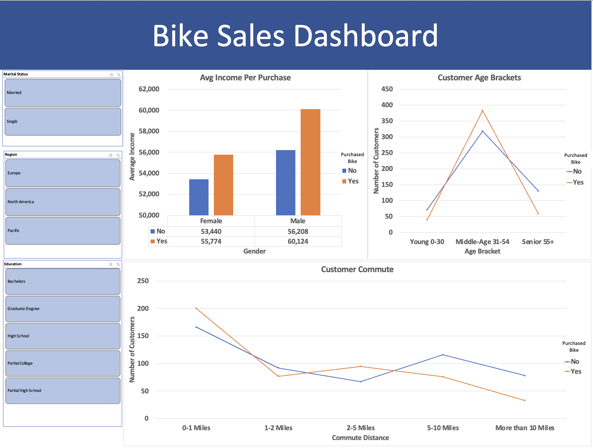

# Bike Sales Dashboard: Customer Segmentation and Purchase Drivers

An interactive Excel dashboard that analyzes customer data to identify which income, age, and commute segments are most likely to purchase a bike. The goal was to turn raw transactional data into clear, decision-ready insights that a sales or finance team could use to prioritize spending and target the highest-value customers.

## Business Question

Which customer segments generate the most bike purchases, and where should the business focus its marketing budget to get the best return?

## Skills Demonstrated

- **Data cleaning and validation:** Removed duplicate records and standardized inconsistent values to make the dataset reliable for analysis.
- **Data modeling:** Created calculated fields such as age brackets to segment customers into meaningful groups.
- **Financial and comparative analysis:** Compared average income and customer counts between buyers and non-buyers to quantify the gap in each segment.
- **Pivot tables and pivot charts:** Summarized large volumes of records into concise metrics.
- **Dashboard design and reporting:** Built a single-page dashboard with slicers so non-technical stakeholders can filter results by marital status, region, and education on their own.
- **Communicating insights:** Translated the numbers into specific, actionable business recommendations.

## Tools Used

- Microsoft Excel (Pivot Tables, Pivot Charts, Slicers, calculated columns)

## Dashboard Components

| Chart | What It Measures | Why It Matters |
|---|---|---|
| Avg Income Per Purchase | Average income of buyers vs. non-buyers, by gender | Shows how purchasing power relates to buying decisions |
| Customer Age Brackets | Number of buyers vs. non-buyers by age group | Identifies the age segment with the highest conversion |
| Customer Commute | Number of buyers vs. non-buyers by commute distance | Reveals how lifestyle factors drive demand |
| Slicers | Marital Status, Region, Education | Lets users drill into any segment and see all charts update at once |

## Process

1. **Data preparation:** Removed duplicates and replaced coded values (such as M/F and M/S) with readable labels to ensure accuracy and consistency.
2. **Feature creation:** Added an age bracket column to group customers into Young (0-30), Middle-Age (31-54), and Senior (55+) segments.
3. **Analysis:** Built pivot tables to calculate average income and customer counts for buyers and non-buyers across each segment.
4. **Visualization:** Converted each pivot table into a pivot chart and formatted it for clarity.
5. **Reporting:** Combined all charts on one dashboard and connected every chart to shared slicers for interactive filtering.

## Key Findings

**1. Higher income is linked to higher purchase likelihood.**
Buyers earned more on average than non-buyers in both gender groups.

| Gender | Avg Income (Did Not Buy) | Avg Income (Bought) | Difference |
|---|---|---|---|
| Female | 53,440 | 55,774 | +2,334 (4.4%) |
| Male | 56,208 | 60,124 | +3,916 (7.0%) |

**2. Middle-aged customers are the core market.**
Customers aged 31-54 form the largest group, and it is the only age bracket where buyers outnumber non-buyers. Young and senior customers purchase at noticeably lower rates.

**3. Short commutes drive demand.**
Customers who live 0-1 miles from work are the most likely to buy. Purchases decline as commute distance increases, with the lowest purchase volume among customers commuting more than 10 miles.

## Business Recommendations

- **Focus marketing spend on middle-aged, higher-income customers,** since this group shows the strongest purchase behavior and the highest likely return on investment.
- **Target customers who live close to work,** for example through urban and city-center campaigns, where demand is highest.
- **Reconsider spending aimed at long-distance commuters and senior customers,** or test different products (such as e-bikes) that may better fit their needs before committing more budget.

## Conclusion

This project shows how raw customer data can be cleaned, segmented, and analyzed to answer a clear business question. The result is a dashboard that highlights where revenue opportunities are strongest and supports data-driven decisions about where to allocate marketing budget.
